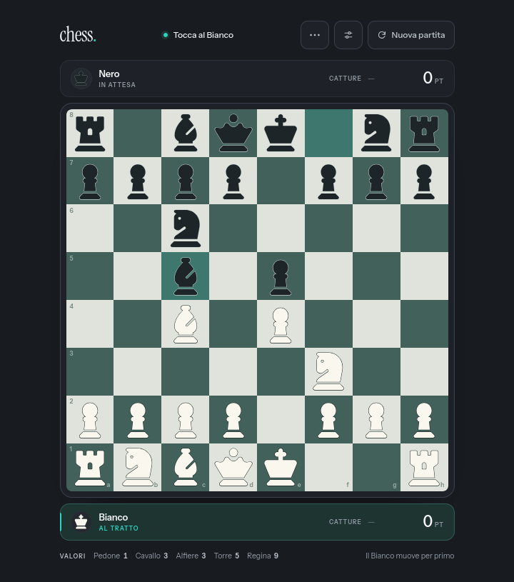

<p align="center">
  
</p>

<h1 align="center">Chess</h1>

<p align="center">Two-player chess on the same device.</p>

<p align="center">
  
</p>

Chess is a local two-player chess game available in Italian and English. By default the interface follows the browser language, with English as the fallback. It is designed for tablets and desktops, with the board oriented with White at the bottom.

There are no dependencies to install and no build step: open `index.html` in your browser.

## Getting started

Double-click `index.html`, or serve the folder with a local server:

```sh
python3 -m http.server 8000
```

Then visit `http://localhost:8000`.

## How to play

- Tap or click a square, then the destination square. Legal moves are highlighted and captures have a dedicated border. If a piece has no legal moves, the status bar shows "No moves".
- To castle, select the king and move it two squares toward a rook (`e1` → `g1`/`c1` for White, `e8` → `g8`/`c8` for Black), or select the king and click the highlighted home rook. The rook is highlighted only when castling is legal.
- A piece can be stuck even if it looks free on the board: moving it would leave its own king in check (a pinned piece). When the king is in check, only moves that resolve the check are legal.
- Keyboard: arrow keys move across the board, `Home`/`End` go to the first/last square, `Enter` selects and moves, `Esc` cancels the selection or closes a dialog.
- The settings, about, promotion, confirmation, and result dialogs can also be dismissed by tapping or clicking the empty backdrop.
- The `⋯` menu lets you offer a draw or resign. The reload button starts a new game (with confirmation if a game is in progress).
- Captured pieces and the material score update in real time: pawn 1, knight 3, bishop 3, rook 5, queen 9.

The game handles check, checkmate, stalemate, castling, en passant, promotion, threefold repetition, the fifty-move rule, insufficient material, agreed draws, and resignation. Rules follow [Learn How to Play Chess](https://www.chess.com/learn-how-to-play-chess).

## Settings

The gear in the top bar, or "Settings" in the `⋯` menu, opens the preferences:

- **Theme**: Dark, Light, or System. System is the default and follows the device setting.
- **Language**: System, Italian, or English. System is the default and follows the browser language; if neither Italian nor English is preferred, the interface falls back to English.
- **Coordinates**: show or hide files and ranks along the edges.
- **Highlight last move**: keeps the start and destination of the last move visible.
- **Animations**: enables or disables animations and transitions.
- **Confirm before a new game**: prevents accidentally resetting the game.

Preferences are saved in `localStorage` (key `chess.prefs`) and restored on reload. "Reset to defaults" returns to the system theme, system language, and all options enabled. On narrower screens the gear is hidden, but settings remain available from the `⋯` menu.

At the bottom of settings, "About and credits" opens a panel with a game description, rules engine, piece icons, fonts, site icon, project licence, and links to the bundled licence files.

## Project structure

- `index.html` — interface, theme bootstrap, and SVG piece sprite
- `styles.css` — layout, dark/light/system themes, responsive rules, and motion
- `app.js` — game state, input, dialogs, rendering, language, and preferences
- `vendor/chess.js` — rules engine (chess.js 1.4.0)
- `fonts/` — Instrument Sans and Instrument Serif, self-hosted
- `licenses/` — font, icon, and site-icon licences
- `favicon.svg` — site icon derived from Material Symbols Rounded
- `LICENSE` — GNU General Public License v3.0 for the Chess source code
- `docs/` — screenshot used in this README
- `_headers` — CSP and security headers for Cloudflare Pages (ignored locally)

## Licence

Copyright © 2026 Chess contributors.

The Chess source code is free software: you can redistribute it and/or modify it under the terms of the **GNU General Public License v3.0** (GPL-3.0-only) as published by the Free Software Foundation. See [LICENSE](LICENSE) for the full text.

Chess is distributed in the hope that it will be useful, but **without any warranty**; without even the implied warranty of merchantability or fitness for a particular purpose. See the GNU General Public License for more details.

Third-party components remain under their own licences and are not relicensed by the GPL:

- [chess.js](https://github.com/jhlywa/chess.js) — Copyright © 2025 Jeff Hlywa, BSD-2-Clause. Text in `vendor/chess.LICENSE.txt`.
- Piece icons: [Font Awesome Free](https://fontawesome.com) 6.7.2 — Copyright © 2024 Fonticons, Inc. Icons are CC BY 4.0, recoloured and outlined for the themes. See `licenses/FontAwesome-Free-License.txt`.
- [Instrument Sans](https://fonts.google.com/specimen/Instrument+Sans) and [Instrument Serif](https://fonts.google.com/specimen/Instrument+Serif) — SIL Open Font License 1.1. See `licenses/`.
- Site icon: [Material Symbols Rounded](https://github.com/google/material-design-icons) `chess_pawn` (Google) — Apache License 2.0, recoloured, rescaled, and with two zero-area subpaths removed. See `licenses/Apache-2.0-MaterialSymbols.txt`.

## Deployment, privacy, and cookies

The site is static and can be deployed to Cloudflare Pages without a build. The public instance is intended to be served at `chess.poppi.cc`. The `_headers` file sets the Content Security Policy and security headers; Cloudflare Pages applies it automatically. It is ignored locally (`file://` or a development server). If you change the inline theme script in `index.html`, update the `sha256-…` hash in the `_headers` CSP. For Cloudflare Pages, publish the contents of the project root (with `index.html` and `_headers` at the site root), not a wrapper folder.

Chess does not use cookies, analytics, advertising, or tracking, and does not send games to external services. Preferences (theme, language, coordinates, last move, animations, new-game confirmation) are stored only in the browser's `localStorage` and are not transmitted. There are no forms, accounts, or data sent to a server.

When hosted on Cloudflare Pages, Cloudflare may process technical request metadata (such as IP address and user agent) to deliver and protect the service, under its own privacy policy. Chess sets no cookies of its own.

Requires a modern browser with support for `<dialog>`, container queries, and `dvh` units (recent Chrome, Edge, Firefox, and Safari).
